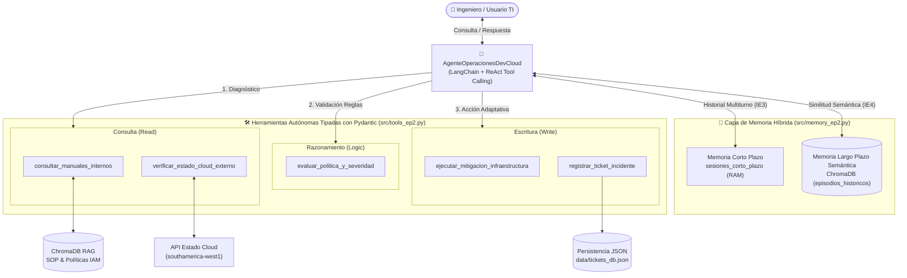

# ☁️ DevCloud Agent: Agente Autónomo para Operaciones Cloud y Mesa de Ayuda TI

**Asignatura:** ISY0101 - Ingeniería de Soluciones con IA (Duoc UC)  
**Evaluación:** Parcial N°2 (EP2)  
**Caso Organizacional:** DevCloud Solutions SpA  

## 📌 Descripción del Proyecto
Este repositorio contiene la implementación de **DevCloud Agent**, un agente autónomo basado en IA diseñado para resolver incidentes de infraestructura, evaluar políticas de seguridad de forma determinista y aplicar mitigaciones en la nube (ej. Kubernetes, PostgreSQL). 

El agente utiliza un bucle **ReAct (Reason + Act)** con *Tool Calling* estricto (Pydantic), y cuenta con una arquitectura de **Memoria Híbrida** (corto plazo en sesión y largo plazo semántica) para mantener coherencia en flujos operacionales complejos sin alucinaciones.

---

## 🏗️ Arquitectura de Componentes

El proyecto está modularizado en los siguientes componentes principales:
* **Orquestador (`src/agent_ep2.py`):** Controla el flujo ReAct, planifica tareas y gestiona la toma de decisiones adaptativas (IE2, IE5, IE7).
* **Herramientas Tipadas (`src/tools_ep2.py`):** 
  * *Consulta (Read):* RAG Interno en ChromaDB (`consultar_manuales_internos`) y Mock de API Cloud regional (`verificar_estado_cloud_externo`).
  * *Razonamiento (Logic):* Motor determinista que evalúa SLAs (P1/P2/P3) y reglas de seguridad (`evaluar_politica_y_severidad`), bloqueando reinicios y aperturas de puertos en producción.
  * *Escritura (Write):* Ejecución de mitigaciones en infraestructura (`ejecutar_mitigacion_infraestructura`) y persistencia auditable en base de datos JSON (`registrar_ticket_incidente` en `data/tickets_db.json`).
* **Gestor de Memoria Híbrida (`src/memory_ep2.py`):** Mantiene el historial de la sesión activa en RAM (corto plazo, IE3) y una base episódica vectorial en ChromaDB (largo plazo en `data/long_term_memory_db/`, IE4).
* **Pipeline RAG Base (`src/rag_pipeline.py` & `src/ingestion.py`):** Base de conocimiento documental desarrollada en la EP1.



---

## ⚙️ Requisitos Previos

* **Python:** 3.10 o superior (verificado en Python 3.11).
* **Clave API:** Una API Key de Google Gemini (`GEMINI_API_KEY`) u OpenAI (`OPENAI_API_KEY`).

---

## 🚀 Instalación y Configuración

Sigue estos pasos para clonar y preparar el entorno de ejecución:

**1. Clonar el repositorio**
```bash
git clone https://github.com/christiancarriel2sisb-sys/devcloud-rag-assistant.git
cd devcloud-rag-assistant
```

**2. Crear y activar el entorno virtual**
```bash
python -m venv .venv

# En Windows (PowerShell):
.venv\Scripts\Activate.ps1

# En macOS/Linux o Git Bash:
source .venv/bin/activate
```

**3. Instalar dependencias**
```bash
pip install -r requirements.txt
```

**4. Configurar variables de entorno**
Crea un archivo llamado `.env` en la raíz del proyecto y configura tu clave de API (compatible tanto con Google Gemini como con OpenAI):
```env
GEMINI_API_KEY=tu_api_key_aqui
OPENAI_API_KEY=tu_api_key_aqui
CHROMA_PERSIST_DIRECTORY=data/vector_store
```

---

## ▶️ Instrucciones de Ejecución y Pruebas

Para que el evaluador pueda validar el correcto funcionamiento del agente y la persistencia de datos, se deben ejecutar los siguientes scripts en orden:

### Paso 1: Inicializar la Base de Conocimiento Interna (RAG - EP1)
Carga los manuales técnicos (`.txt`) en la base de datos vectorial ChromaDB.
```bash
python -m src.ingestion
```
*(Se confirmará en consola que la base vectorial fue indexada exitosamente con sus fragmentos en `data/vector_store/`).*

### Paso 2: Ejecutar la Demostración del Agente Autónomo (EP2)
Este script lanza dos escenarios simulados para demostrar la **toma de decisiones adaptativa**:
1. **Fallo en Staging:** El agente autoriza la solución y aplica mitigación automática (`+25% RAM`), registrando el ticket `INC-1001` como `RESUELTO_AUTOMATICO`.
2. **Fallo en Producción:** El motor de reglas bloquea el reinicio directo según `[SOP-TI-2026-V1]`, y el agente adapta su plan absteniéndose de tocar la infraestructura y escalando el ticket `INC-1002` a `ESCALADO_A_SRE`.

```bash
python -m src.agent_ep2
```
*(Al finalizar, se puede revisar el archivo `data/tickets_db.json` para auditar los tickets generados por el agente en disco y la carpeta `data/long_term_memory_db/` con la memoria episódica).*

### Paso 3: Ejecutar la Suite de Pruebas Automatizadas (Pytest)
Para validar técnicamente todos los indicadores de la pauta de evaluación (IE1, IE3, IE4, IE5, IE7):
```bash
pytest tests/test_agent_ep2.py -v
```
*(Los 4 tests pasan exitosamente al 100% en verde).*

Para ejecutar también las pruebas del pipeline RAG base (EP1):
```bash
pytest tests/ -v
```

---

## 📄 Documentación Formal
* **Informe Técnico Oficial (Word):** [`Informe_Tecnico_EP2_DevCloud_Agent.docx`](Informe_Tecnico_EP2_DevCloud_Agent.docx) (5 páginas con formato institucional Duoc UC, diagramas, justificaciones y tablas de auditoría).

---

## 👥 Autores
* **Christian Carriel Aldas**

